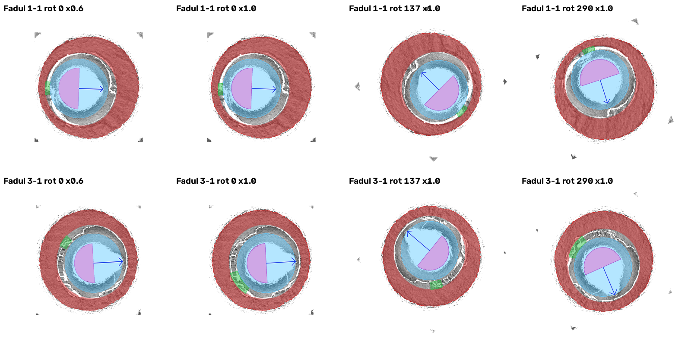

# Automatic masking of cartridge case head scans

Repository: <https://github.com/ibrakadabra70/cartridge-masking>
(`git clone https://github.com/ibrakadabra70/cartridge-masking.git`, see
[Quick start](#quick-start-windows-11-powershell)).

Automatically detects and colour-masks the regions of a cartridge case head
scan (3D topography rendering), following the colour scheme of the
assignment:

| # | Region | Colour |
|---|--------|--------|
| 1 | Breech-face impression | red |
| 2 | Aperture shear | green |
| 3 | Firing pin shear | purple |
| 4 | Firing pin impression | light blue |
| 5 | Firing pin drag | blue arrow (from the impression's centre towards the drag) |

Developed and evaluated on the **NIST Ballistics Toolmark Research Database,
Fadul 2011 study** (9 mm Luger, Ruger P95, 10 consecutively manufactured
slides, 40 scans including the 20 "unknowns").


---

## Results at a glance (all 40 Fadul 3DVM scans)

| | Result |
|---|---|
| Scans processed | **40 / 40**, no failures, ~0.6 s per scan |
| Breech face (red) + firing pin impression (light blue) | correct on all 40 by visual inspection ([contact sheet](outputs/samples/fadul_all_40_contact_sheet.png)) |
| Aperture circle | found on all 40, incl. 3 off-centre scans (8-1, Q, X) |
| Firing pin drag | detected on 24 / 40. **Every detected drag points the same way (359°–7°)**, which is expected because all ten guns are the same model. The remaining 16 impressions are close to round. |
| Aperture shear | found on 38 / 40. 36 of the 38 lie on the side opposite the drag (134°–248°). |
| Rotation / scale test | sizes change by ≤ 18 µm and the drag angle by ≤ 0.6° when scans are rotated or rescaled 0.6×–1.5× |

More sample figures: [Fadul 1-1](outputs/samples/Fadul%201-1/side_by_side.png) ·
[Fadul 3-1](outputs/samples/Fadul%203-1/side_by_side.png) ·
[Fadul 7-1 (no drag)](outputs/samples/Fadul%207-1/side_by_side.png) ·
[Fadul X (off-centre scan)](outputs/samples/Fadul%20X/side_by_side.png)

---

## Quick start (Windows 11, PowerShell)

Requires **Python 3.14** (other recent 3.x versions should work too) and
**Git** (install it from <https://git-scm.com/download/win> or with
`winget install --id Git.Git -e`, then open a new PowerShell window).

```powershell
# 1. Clone the repository and enter it
git clone https://github.com/ibrakadabra70/cartridge-masking.git
cd cartridge-masking
#    (no Git? On the GitHub page use Code > Download ZIP, extract it,
#     and cd into the extracted cartridge-masking-main folder instead)

#    To get later updates:  git pull

# 2. Create and activate a virtual environment
py -3.14 -m venv .venv
.\.venv\Scripts\Activate.ps1
#    If PowerShell refuses to run the script, allow it once for your user:
#    Set-ExecutionPolicy -Scope CurrentUser -ExecutionPolicy RemoteSigned
#    (or skip activation and use .\.venv\Scripts\python.exe instead of python)

# 3. Install the pinned dependencies
python -m pip install --upgrade pip
python -m pip install -r requirements.txt

# 4. Run on the 5 sample scans shipped with the repository
python run.py --input data/samples --output outputs/my_run

# 5. (optional) Run the tests
python -m pytest -q
```

Open `outputs\my_run\<scan name>\side_by_side.png` to see the result, or
`outputs\my_run\contact_sheet.png` for all scans at once.

### Command-line options

```powershell
python run.py --input <file or folder> [--output outputs] [--um-per-px 3.12] [--use-x3p] [--no-figures]
```

| Option | Meaning |
|---|---|
| `--input`, `-i` | One image, or a folder (all `*3DVM*` images in it; any image if none are named like that) |
| `--output`, `-o` | Where results go (default `outputs`) |
| `--um-per-px` | Force the pixel size in µm. By default it is read from the scale bar in the image header. |
| `--use-x3p` | Advanced mode: for each scan, read the matching `.x3p` file in the same folder (e.g. `Fadul 1-1.x3p`) and measure that scan's own firing-pin-impression rim from real heights |
| `--no-figures` | Skip the side-by-side figures (faster for large batches) |

### Batch processing the full Fadul set

Download the Fadul 2011 study from the
[NIST Ballistics Toolmark Research Database](https://tsapps.nist.gov/NRBTD/)
into `data/raw/fadul_2011/` (the code never modifies that folder), then:

```powershell
python run.py --input data/raw/fadul_2011 --output outputs/fadul_full
python run.py --input data/raw/fadul_2011 --output outputs/fadul_x3p --use-x3p
```

### Outputs

Per scan, in `<output>/<scan name>/`:

| File | Content |
|---|---|
| `side_by_side.png` | Original \| overlay, colour legend, key measurements |
| `overlay.png` | Full-resolution overlay |
| `mask_colour.png` | Coloured regions on black |
| `labels.png`, `labels.npy` | Label image, one integer per pixel: 0 background, 1 breech face, 2 aperture shear, 3 firing pin shear, 4 firing pin impression |

Per run: `summary.csv` (one row per scan: scale, centre, radii in px and mm,
areas in mm², drag detected / angle / strength / length, aperture shear
sector, warnings, status) and `contact_sheet.png`.

**Angle convention:** 0° = pointing right, counter-clockwise positive
(90° = up), as seen on the image.

---

## Methodology

### What the input looks like

The primary input is the `3DVM.PNG` export: a shaded rendering of the 3D
measurement. The breech face is a textured outer ring, the firing pin
impression is a crater in the centre, and the two are separated by a thin
white arc. The key observation used throughout:

> **Pure white (≥ 250) means "no data"**: the confocal microscope could not
> measure steep or deep surfaces. The deepest part of the firing pin crater
> and the step at the aperture edge are therefore white.

To understand the geometry before writing any rules, I loaded the `.x3p`
height maps (a small reader is included; no extra package is needed).
Radial height profiles showed that inside the aperture, primer metal
**flows back into the firing-pin hole and forms a raised ring**. The firing
pin crater is punched into that ring:

```
height
  ^          crest                     crest
  |         .-'''-.                   .-'''-.
  |   BF   /       \     crater      /       \   BF
  |_______/         \               /         \_______
  |                  \_____________/
  +-------|---------|------|------|---------|------> radius
       aperture    rim    white blob        rim   aperture
         edge     (FPI boundary)
```

This picture drives the design. Everything is measured **in polar
coordinates around detected circles**, and every size is a **fraction of
the detected primer radius R**, so the method does not depend on orientation
or pixel size.

### Pipeline

```
load PNG ─► primer disc ─► firing-pin blob ─► aperture circle
                 │               │                  │
                 ▼               ▼                  ▼
           breech face     FPI + drag        aperture shear
              (red)     (light blue, arrow,    (green)
                         purple)
```

**0. Loading and scale** ([io_utils.py](src/io_utils.py)). The top 60 px
(file path and scale bar) are cropped off. The header shows two pixel sizes:
`data: 3.12 um/px` is the sampling of the raw 3D data, but the PNG was
resampled for display. The pixel size of the PNG itself is read from the
**scale bar ticks** (0.5 mm apart). This gives 3.27 µm/px for the numbered
scans and 3.15 µm/px for the lettered ones. Using 3.12 would make every mm
measurement about 5 % too small. If no scale bar is found, the code falls
back to 3.12 µm/px or the `--um-per-px` value, and says so in the warnings.

**1. Primer** ([primer.py](src/primer.py)). Measured mask (`< 250`) →
opening and closing with a ~15 px kernel → largest connected component
(removes the scan fragments in the corners) → fill the outer contour →
centre from image moments, radius = √(area/π). If the disc touches the image
border, a least-squares circle is fitted to the free part of the outline
instead.

**2. Firing pin blob** ([firing_pin.py](src/firing_pin.py)). The white
component closest to the centre, after an opening of 0.04 R that erases thin
white arcs so they cannot merge with it. Its **round core** is found by
starting at the largest inscribed circle (distance-transform maximum) and
then fitting a circle to the outline repeatedly while **dropping outward
outliers only**. The drag bulge therefore does not pull the circle off.

**3. Aperture edge** ([aperture.py](src/aperture.py)). The white arc is
broken, sometimes over half its length, so it is not traced. Two priors are
used instead: the aperture is a **circle**, and it is roughly **concentric
with the crater** (radius 1.45–2.1 × the core radius; measured
1.62–1.85 on Fadul). A RANSAC search proposes circles through 3 random white
pixels and scores each one by **angular coverage**: in how many of 360
angular bins a white pixel lies on the circle. A real arc covers many angles
at one radius; speckle does not. The best circle is refined by least
squares.

**4. Firing pin impression rim (light blue)**. The FPI boundary is the
**crest** of the flow-back ring, which the shaded PNG barely shows. Its
position was therefore **calibrated on the 3D data**.
[tools/calibrate_with_x3p.py](tools/calibrate_with_x3p.py) runs the same
detection on all 40 `.x3p` files (missing points play the role of white
pixels) and finds the highest ring of the radial height profile. That ring
lies a median **61 %** of the way from the core circle to the aperture edge
(10th–90th percentile 51–76 %). This fraction has no units, so it transfers
to the PNGs. With `--use-x3p`, each scan uses its own measured value instead.
The 3D data also independently confirmed the aperture/core ratio (1.69–1.91).

**5. Firing pin drag (blue arrow)**. Blob pixels outside the core circle
(+8 %) form the drag bulge. A drag is reported if the bulge covers
≥ 1.5 % of the core area **and** reaches ≥ 18 % of the core radius beyond it.
The arrow goes from the core centre towards the bulge's centroid and ends at
the bulge's farthest point. `drag_strength` in the CSV = reach / core radius
(0 = perfectly round).

**6. Aperture shear (green)** ([shear.py](src/shear.py)). During unlocking,
the aperture edge scrapes the flow-back and leaves parallel striations that
run roughly **radially**. In the rendering they appear as a "ladder" of short
white dashes. Detection:
- The band between the FPI rim and the aperture edge is unwrapped into a
  (radius × angle) image. Radial striations become vertical streaks, and the
  arc becomes a horizontal line.
- For each angle, the code counts white↔grey transitions along the angle
  direction. This dash density is high on striations and ~0 on the
  continuous arc.
- The peak of the smoothed profile is taken, searching only on the side
  facing away from the drag when a drag is known. It is accepted if it is
  ≥ 2× the scan's median, and the green sector is grown out to half height.

An earlier version used structure-tensor orientation and was rejected: the
lighting of the rendering makes the whole image look striated in one
direction.

**7. Firing pin shear (purple)**. This follows the **reference figure in
the assignment** (page 2), where the round, trailing part of the impression
is purple and the part extending towards the drag arrow is light blue. It
is reproduced geometrically as the half of the core circle that lies behind
the line through the core centre perpendicular to the drag. No drag → no
purple.

**8. Labels.** Breech face = primer outside the aperture (+0.02 R margin, so
the white arc is excluded), with large no-data voids left out. Every pixel
gets one label. Priority, highest first: firing pin shear > firing pin
impression > aperture shear > breech face. The flow-back ring between the
aperture edge and the FPI rim is deliberately **not** masked, as in the
reference figures.

---

## Assumptions

- Input is a 3DVM-style rendering in which unmeasured points are pure white
  and the primer is roughly centred. The outer brass case is **not** in the
  image: NIST cropped the scans to the primer. The "primer radius" reported
  is therefore the radius of the **measured region** (median 1.77 mm), not
  of the whole primer cup.
- The aperture is circular and roughly concentric with the firing pin crater.
- The firing pin impression is a crater whose deepest part is not measured
  (a large white blob). A shallow impression that is fully measured would not
  be detected; see limitations.
- Aperture shear lies near the aperture edge and, when a drag exists, on
  the side facing away from it.

## How reliable is each region?

| Region | Confidence | Why |
|---|---|---|
| Breech face (red) | **High** | Directly from the measured / no-data mask plus a robust aperture circle |
| Firing pin impression (light blue) | **High** for position, **medium** for exact rim | Core circle and aperture are robust. The rim uses a fraction calibrated on 3D data whose scan-to-scan spread is ±0.1 of the core→aperture distance (≈ ±40 µm). `--use-x3p` removes this error when x3p files exist. |
| Firing pin drag (arrow) | **High** when strong, **medium** when weak | Direction is very stable (≤ 0.6° under rotation; all 24 detections agree within 9°). Weak teardrops (strength 0.18–0.25, e.g. 1-1, E, C) sit close to the threshold. |
| Aperture shear (green) | **Medium–low** | It finds the *location* (right side of the circle on 36/38) but usually *underestimates the extent* (e.g. 3-1: the ladder spans ~150–240°, the green sector 201–238°). Under rotation the peak moved > 15° in 11 of 49 cases, because interpolation changes the dash pattern. |
| Firing pin shear (purple) | **Convention, not measurement** | A geometric split that copies the assignment's reference figure. It is only as good as the drag direction. |

## Edge cases and where it struggles

| Scan(s) | Issue | How it is handled / result |
|---|---|---|
| 8-1, Q, X, P | Primer off-centre; the breech-face ring is missing at the bottom-left and the aperture arc merges with the background | Aperture candidates are taken from an annulus around the crater instead of from the primer region. Circles are correct. The red ring is (correctly) incomplete there. |
| 1-1, 1-2, F, M | The white arc is very fragmented, with double arcs on the left | The first version picked a too-large circle and reported fake leftward drags. Fixed by finding the blob first and constraining the aperture to be concentric with it. |
| 4-1, 7-x, 8-x, 9-1, B, F, I, N, Q, R, T, Y, Z | Round impression | No drag, no purple (correct for clearly round ones; 4-2, B, N, Z have small bulges just below the threshold) |
| Q, X | Aperture shear placed at 300°/284° (lower right) instead of the usual left side | Q has no drag, so the search is unrestricted. X's peak lies at the edge of the allowed half. Likely wrong. |
| K, S | No aperture shear found | Dash peak below 2× the median: the ladder is faint or absent |
| E | A large disturbance at the bottom of the aperture (a "bubble") | Not mistaken for shear; the sector (151–216°) covers the striations on the left |
| Corner fragments | Small scan patches in the 4 corners | Removed by the largest-component step |
| Missing / unreadable scale bar | e.g. a cropped image | Falls back to 3.12 µm/px or `--um-per-px`, with a warning in the CSV |
| Any step fails on an image | | That row gets `status = failed: <reason>` and the batch continues |

## Generalisation (bonus)

Only one calibre was available (Fadul = 9 mm Luger), so the method cannot
be shown on another calibre directly. What changes between calibres and
instruments is mainly **size in pixels** and **orientation**, and the
code is designed around that:

- every length is a fraction of the detected primer radius R or of the
  crater's core radius ([config.py](src/config.py));
- every directional decision is made relative to detected circles and the
  detected drag, never in fixed image directions;
- the pixel size is read from the image itself.

[tools/robustness_check.py](tools/robustness_check.py) tests this by
rotating the 5 sample scans by 6 angles and rescaling them 0.6×–1.5×
(50 transformed scans):

| Quantity | Median error | Max error |
|---|---|---|
| Primer radius | 2 µm | 18 µm |
| FPI rim radius | 3 µm | 14 µm |
| Drag angle (after undoing the rotation) | 0.05° | 0.6° |
| Drag detected yes/no | unchanged 50/50 | |
| Aperture shear peak | 0.5° | 122° (11/49 > 15°) |



The same detection code also runs unchanged on the x3p height maps (a
different modality, at 3.125 µm/px), which is how the rim calibration
works.

For a new calibre or firearm type, check these first:
`aperture_r_over_core` (aperture size relative to the firing pin), the
`fpi_rim_fraction` (re-run the calibration tool if x3p data exist), and the
drag thresholds. Guns with a rectangular firing pin (e.g. Glock) or no
aperture shear would need new rules for the shape of the impression.

---

## Project structure

```
cartridge-masking/
├── run.py                      # CLI: single file or folder, writes outputs + summary.csv
├── src/
│   ├── config.py               # every tunable parameter, documented (fractions of R)
│   ├── io_utils.py             # PNG loading, header crop, scale bar, x3p reader
│   ├── geometry.py             # circles, RANSAC helpers, polar unwrap, morphology
│   ├── primer.py               # step 1: primer disc
│   ├── firing_pin.py           # steps 2, 4, 5: blob, core, rim, drag
│   ├── aperture.py             # step 3: aperture circle (RANSAC + angular coverage)
│   ├── shear.py                # steps 6, 7: aperture shear, firing pin shear
│   ├── topography.py           # x3p crest measurement (calibration and --use-x3p)
│   ├── pipeline.py             # runs the steps, builds the label image, summary row
│   └── visualize.py            # overlay, side-by-side figure + legend, contact sheet
├── tools/
│   ├── calibrate_with_x3p.py   # derives fpi_rim_fraction from 3D data
│   └── robustness_check.py     # rotation / scale invariance test (bonus)
├── tests/test_pipeline.py      # synthetic primer with known answers, scale bar, x3p reader
├── notebooks/01_explore_primer.py   # first exploration script
├── data/samples/               # 5 representative scans (1-1, 3-1, 7-1, E, X)
├── outputs/samples/            # results for the samples + contact sheet of all 40
├── requirements.txt
└── README.md
```

## Limitations and possible improvements

- **Rendering-based.** The PNG pipeline relies on the white no-data pattern
  of this scanner and renderer. A rendering with a different lighting or
  no-data colour would need the threshold (`no_data_threshold`) adjusted.
  Running the same logic directly on x3p heights (partly done for the
  calibration) would be more robust.
- **Aperture shear** localises the sector but not the individual
  striations. Its extent is underestimated, and it is not
  rotation-stable on all scans. Directional filtering at striation scale
  (e.g. Gabor filters on the height map) would be the next step.
- **Firing pin shear** follows a drawing convention rather than measuring
  shearing.
- **No ground truth.** Quality was judged visually by me (not a firearms
  examiner) and with internal consistency checks: agreement between guns,
  between the PNG and 3D data, and under rotation. Hand-annotated masks would
  allow a proper IoU evaluation.
- Validated on one calibre and one firearm model only.

## Data credit

Scans: NIST Ballistics Toolmark Research Database, Fadul et al. (2011),
"An Empirical Study to Improve the Scientific Foundation of Forensic
Firearm and Tool Mark Identification Utilizing 10 Consecutively
Manufactured Slides". The 5 images in `data/samples/` are copied unchanged
from that study for demonstration.
